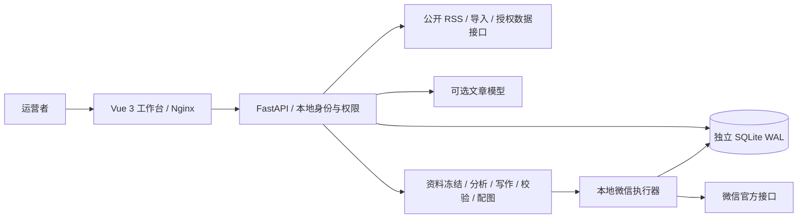

# 架构与状态机

## 模块与数据

`main.py` 提供研究与文章 API；`sources.py` / `catalog.json` 维护来源；`xianyu.py` 提供公开页解析和授权提供方适配；`domain.py` / `editorial.py` 负责确定性分析、时效和文章检查；`illustrations.py` 生成资料图解。

`local_identity.py` 提供 scrypt 密码、本地角色和哈希会话；`local_store.py` 提供按用户隔离账号与 Fernet 密文；`local_publication.py` 负责官方接口、持久化写入意图与最终回执。`publication_bridge.py` 保留已有共享平台的可选适配契约。

数据库分四类：用户/会话/登录限制；账号/加密凭据；来源健康/商品/研究/文章/模型响应；研究任务/投递/步骤回执/审计。schema_version 记录建表版本，当前4。当前只支持单进程运行，SQLite 事务与租约为任务提供排他执行边界。

## 两层任务

研究任务：preflight → collect → analyze → write → validate → illustrate → deliver → reconcile → complete。冻结数据来源、选择依据、正文、图片哈希、账号与交付方式。已生成资讯文章可直接进入同一校验投递流程，不重新调用模型。

官方执行：cover → comparison → risks → draft → submit → query。草稿模式在 draft 后结束；正式模式必须等待 query 最终确认。所有微信写入前持久化 intent；调用成功保存回执，调用结果不明标记 reconciling，自动执行器不重发。查询是只读操作，临时失败可以重试。

## 恢复与去重

- 创建 API 使用 request_id；同编号不同配置返回冲突。
- 同一公众号只允许一个活动研究任务；相同商品内容指纹不重复创建第二篇。
- 每个步骤使用过期租约；迟到回执归档，不覆盖新的执行者。
- 服务重启使研究任务等待登录后继续；已提交的任务继续查询原请求。原模型/采集结果不明不会自动重新调用。
- 本地官方投递保存最长1小时的授权，绑定用户版本、凭据版本和 AppID；角色、密码、凭据变化会阻断旧授权。明确失败可通过“继续原任务”重新授权；结果不明的微信写入必须人工核对。
- 本版不承诺外部接口的 exactly-once。微信部分写入缺少可用的请求幂等键，因此采用“结果不明即停止重发”，避免以重复发布换取表面成功。

已发表状态必须同时具备官方最终成功、文章编号和严格校验的 mp.weixin.qq.com 链接。内部测试、Token连接和草稿 Media ID 均不能代替真实发表验收。
